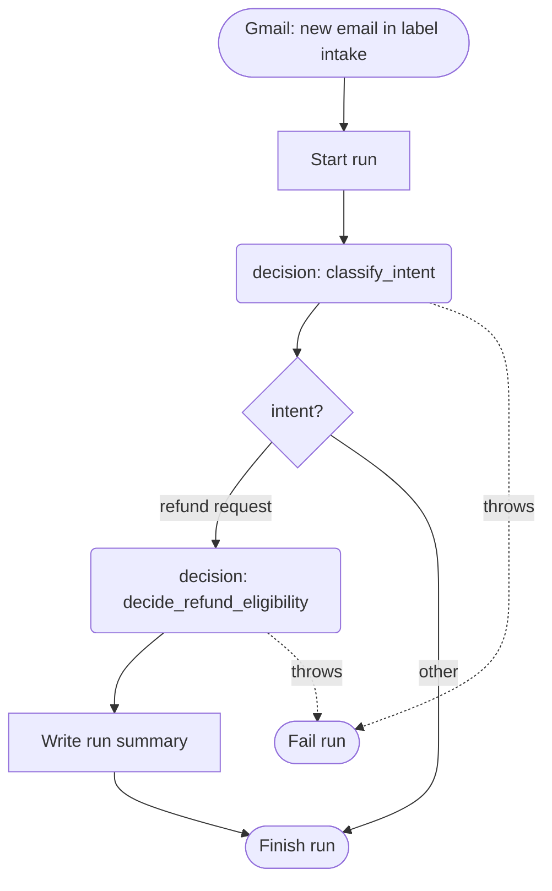

# Mermaid

The dashboard renders Mermaid **11.16.0**. A diagram that fails to parse shows as a plain code block, with no error. Styling belongs to the product: `style`, `classDef`, `linkStyle`, `%%{init}` directives, `click` handlers, icons, and images are ignored or stripped, so write structure and labels only.

## Rules

1. **Quote every node and edge label**, always: `a["forward invoice to [billing@x.com]"]`, `b -- "refund" --> c`. Unquoted labels break on the first `[ ] ( ) { } |`. For a literal `"` inside a label use `#quot;`; there is no backslash escape.
2. **No linter ships with the plugin.** Follow these rules strictly and keep diagrams simple. After pushing, check the rendered Flow description on the agent page; a parse failure shows as a code block.
3. Use `flowchart TD`. Shapes carry meaning: `id["step"]`, `id("decision box")`, `id{"branch?"}`, `id(["start or end"])`. Edges: `-->`, `-- "label" -->`, `-. "throws" .->` for failure paths.
4. Short semantic ids; only the label shows.
5. A node labelled exactly `end` (lowercase) breaks the chart; capitalize or quote it. An id starting with `o` or `x` right after a link reads as an edge type (`A---oB`); add a space or capitalize.

## Example

